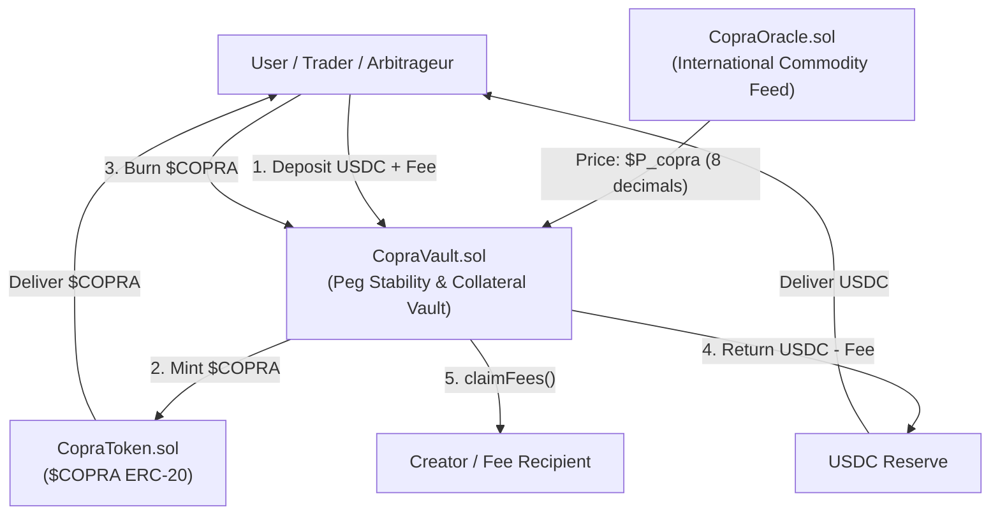
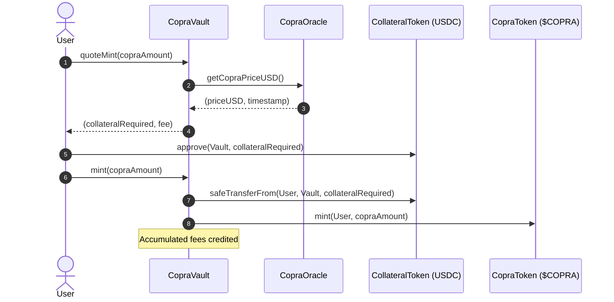

# System Architecture Specification

**Copra Protocol** ([copra.dev](https://copra.dev))  
Target Network: Base L2

---

## 1. High-Level System Diagram



---

## 2. Interaction Sequence: Minting $COPRA



---

## 3. Interaction Sequence: Redeeming $COPRA (Hard Floor)

```mermaid
sequenceDiagram
    autonumber
    actor User
    participant Vault as CopraVault
    participant Oracle as CopraOracle
    participant USDC as CollateralToken (USDC)
    participant Token as CopraToken ($COPRA)

    User->>Vault: quoteRedeem(copraAmount)
    Vault->>Oracle: getCopraPriceUSD()
    Oracle-->>Vault: (priceUSD, timestamp)
    Vault-->>User: (collateralToReturn, fee)

    User->>Vault: redeem(copraAmount)
    Vault->>Token: burnFromVault(User, copraAmount)
    Vault->>USDC: safeTransfer(User, collateralToReturn)
    Note over Vault: User receives dollar value; hard floor maintained
```

---

## 4. Smart Contract Responsibilities

| Contract | State Variables | Core Functions | Access Control |
| :--- | :--- | :--- | :--- |
| **`CopraToken`** | `vault` (immutable) | `mint()`, `burnFromVault()` | Restricted to `vault` only |
| **`CopraVault`** | `collateralToken`, `oracle`, `copraToken`, `accumulatedFees`, `feeRecipient`, `protocolFeeBps` | `mint()`, `redeem()`, `claimFees()`, `quoteMint()`, `quoteRedeem()`, `setFeeRecipient()`, `setProtocolFee()` | Permissionless mint/redeem; `claimFees()` sends to `feeRecipient`; `set*` restricted to `owner` (Ownable2Step) |
| **`CopraOracle`** | `copraPriceUSD`, `lastUpdatedAt`, `feedUpdater` (immutable) | `updatePrice()`, `getCopraPriceUSD()` | `updatePrice()` restricted to `feedUpdater` |
| **`CopraRegistry`** | `collateral`, `oracle`, `vault`, `token`, `version`, `updatedAt` | `setDeployment()`, `getDeployment()` | `setDeployment()` restricted to `owner` (Ownable2Step); the set must be wired to itself |

---

## 5. Security & Invariants

1. **Solvency Invariant**:
   `collateralToken.balanceOf(address(vault)) >= (totalSupply * price) + accumulatedFees`
2. **Flash Loan Resistance**:
   Reentrancy guards on all deposit, redemption, and fee-claiming pathways.
3. **Price Manipulation Protection**:
   `MAX_PRICE_CHANGE_BPS = 2000` (max 20% shift **per update**). There is no minimum interval between updates, so the collar does not bound the updater; see README "Trust Assumptions".
4. **Heartbeat Protection**:
   `HEARTBEAT = 7 days` (reverts if oracle data is older than 7 days).
